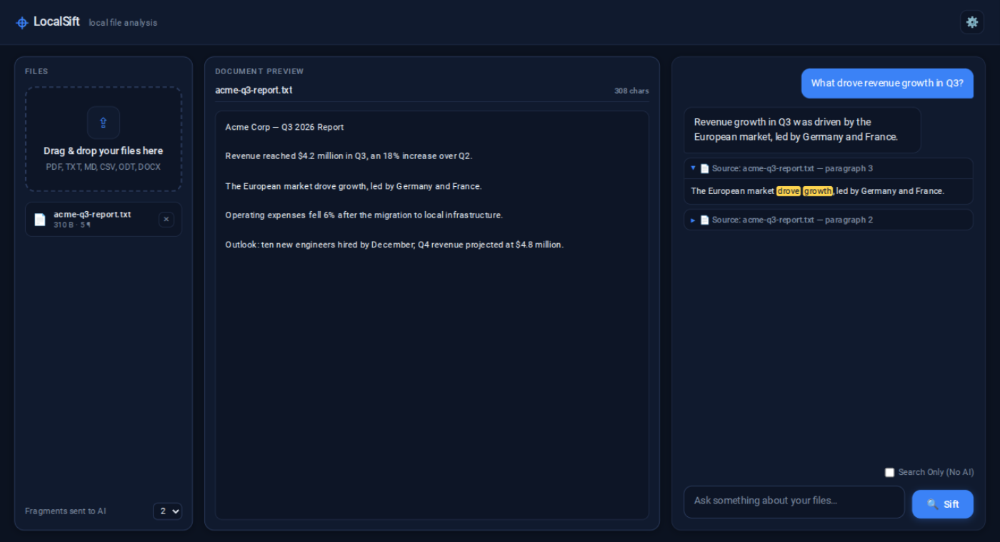

# LocalSift — Ultra-lightweight, Offline RAG Document Assistant

**Ultra-lightweight local RAG. Zero Docker, zero Vector DB, zero Node.js. Pure Python + BM25 + Vanilla JS talking directly to Ollama & KoboldCpp.**

Ask questions about your documents. Everything runs on your machine — no cloud, no accounts, no data leaving your device.

---

## ✨ What it does

LocalSift is a minimal RAG (Retrieval-Augmented Generation) assistant:

1. **Drop a document** into the left panel — the text is extracted locally, in memory (files are never written to disk).
2. **Ask a question** — a rigorous BM25 ranking picks the most relevant fragments of your documents.
3. **Get a grounded answer** — a local LLM answers exclusively from those fragments, always in English, citing the fragment used. If the answer is not in the documents, it says so instead of inventing one.

**New in v1.1.0 — transparency & control:**
- **Expandable citations** — every answer carries the exact BM25 fragments it was built from (click `📄 Source:` to inspect them)
- **Keyword highlighting** — the query terms that triggered the BM25 match are highlighted inside each fragment
- **Search Only mode (No AI)** — skip the LLM entirely and see the raw BM25 results instantly; ideal for slow PCs and exact-word search
- **Top-K selector** — choose how many fragments (1–5) are sent to the AI
- **Stop generation** — a red Stop button interrupts the streaming answer at any time, keeping the partial text

## 📄 Supported formats

TXT · MD · CSV · ODT · DOCX · PDF

(ODT/DOCX are parsed with the Python standard library — no external office suites needed.)

## 📋 Requirements

- Linux (tested on Simply Linux / ALT, works on Ubuntu/Debian)
- **Python 3** (usually pre-installed)
- **pypdf** for PDF support: `pip3 install --user pypdf`
- An AI backend running locally — **Ollama** (default model `qwen2.5:1.5b`) or **KoboldCpp**. LocalSift auto-detects which one is available.

## 🚀 Quick start

1. Download and extract the project folder (anywhere you like — it's portable).
2. Double-click **`LocalSift.desktop`**.
   - If nothing happens: right-click → *Properties → Permissions → "Allow executing file as program"*, or mark the file as *Trusted*.
   - Terminal alternative: `chmod +x start_localsift.sh LocalSift.desktop && ./start_localsift.sh`
3. Your browser opens at `http://127.0.0.1:8200` — drag a file in and ask away.

## 🛠 Troubleshooting

- **CORS Error with Ollama:** If your browser blocks requests to Ollama (port 11434), you may need to allow origins. Run `OLLAMA_ORIGINS="*" ollama serve` in your terminal (or set it as an environment variable) before starting LocalSift.

## 🔒 Privacy

All processing is local: extraction happens in memory, retrieval is pure JavaScript math in your browser, and the only network requests go to `127.0.0.1` (your own machine). Nothing is sent anywhere else. Ever.

## 🛠 Tech notes

- Backend: Python standard library only (`http.server`, `socketserver`) + `pypdf`
- Frontend: a single HTML file — BM25 (k1=1.5, b=0.75) implemented in ~40 lines of vanilla JavaScript
- LLM API: OpenAI-compatible `/v1/chat/completions` with SSE streaming (works with both Ollama and KoboldCpp)
- Model name configurable from the ⚙️ icon in the UI

## 📄 License

MIT
